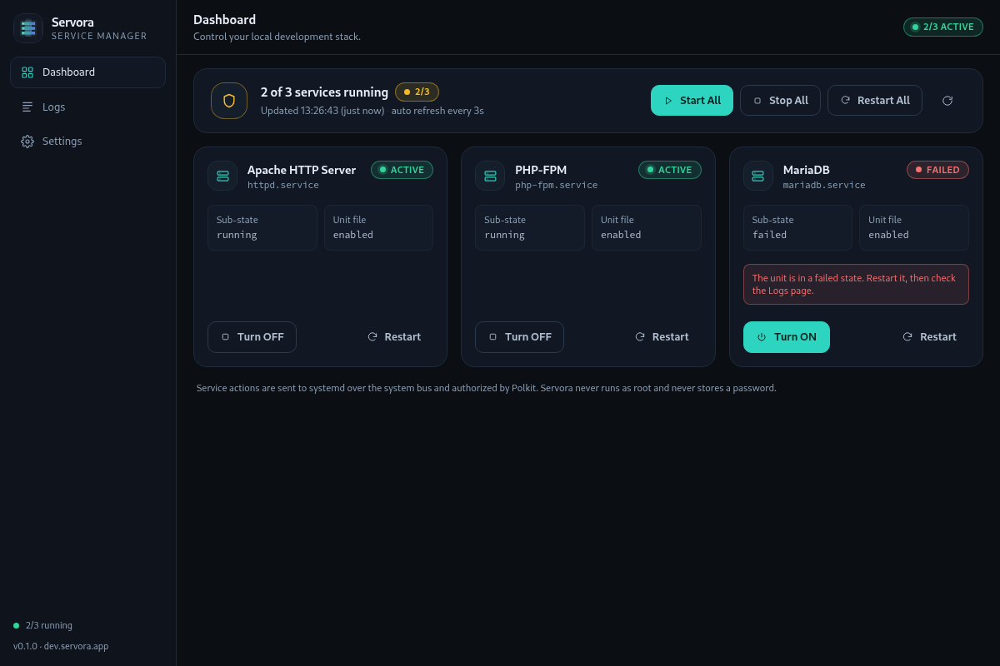
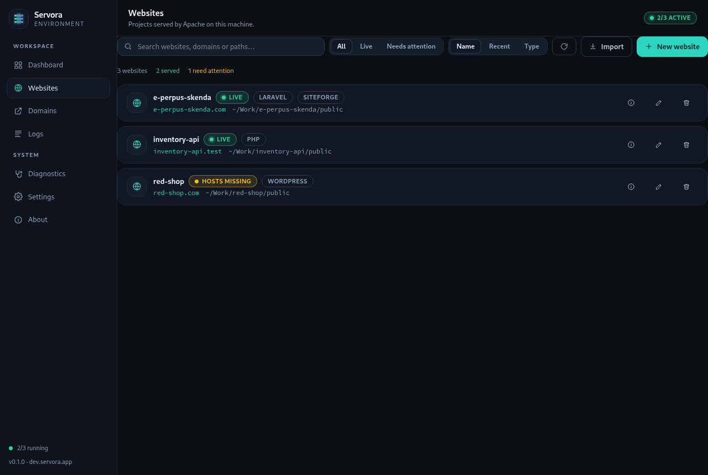
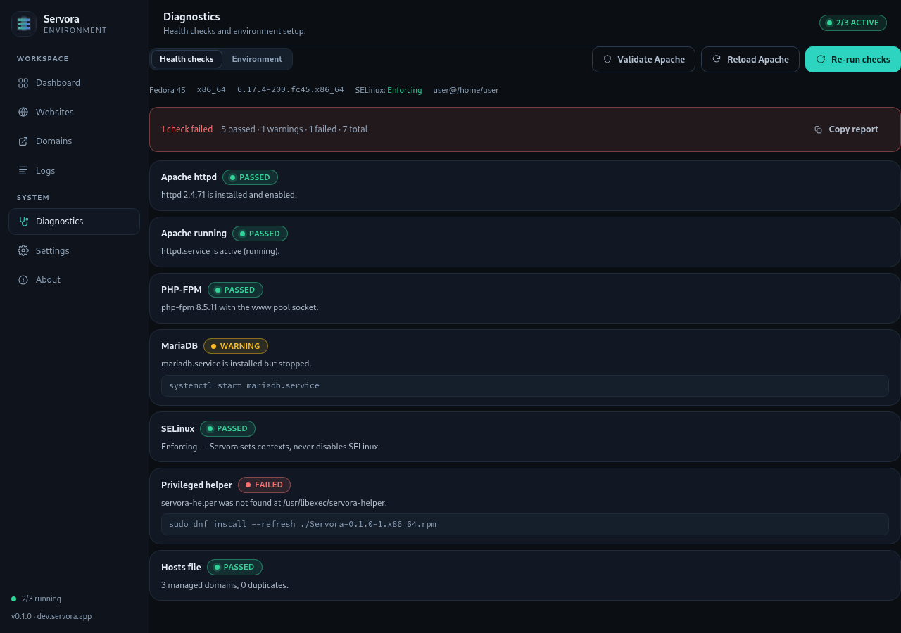

# Servora

**Local Development Environment Manager** — *Your Fedora PHP stack, one window.*

[](https://github.com/Ghaizan17/servora/releases/latest)
[](LICENSE)

**Download:** [latest release](https://github.com/Ghaizan17/servora/releases/latest) — RPM for Fedora, AppImage for everything else.

Servora is a lightweight Linux desktop application for running the services that
power a PHP stack — **Apache HTTP Server**, **PHP-FPM** and **MariaDB** — and for
managing the local websites served by them. It drives the real systemd units
Fedora already ships and writes real Apache configuration, so anything Servora
does is exactly what `systemctl` and `httpd.conf` would do.

The website manager replaces hand-editing VirtualHosts and `/etc/hosts`: point it
at a project folder and it detects the framework, picks the document root, writes
the VirtualHost, adds the domain, sets ACLs and SELinux contexts, validates the
configuration and reloads Apache — as one transaction that rolls back if any step
fails.



| Websites | Diagnostics |
| --- | --- |
|  |  |

> Screenshots are captured from the real interface using the development preview
> harness (`dev/preview.html`), which renders the production frontend against a
> fixed fixture. They show the layout and styling, not live service state.

---

## Features

- **Three managed services** — `httpd.service`, `php-fpm.service`, `mariadb.service`.
  Nothing else can be addressed, ever.
- **Website manager** — create, edit, rename, remove and inspect websites: Apache
  VirtualHost generation, `/etc/hosts` entries inside a marked block, ACLs,
  SELinux file contexts, search/filter/sort, and a details panel that reconciles
  metadata with the live configuration.
- **Project detection** — Laravel, WordPress, generic PHP and unknown projects,
  with automatic document-root discovery and the writable directories each
  framework needs.
- **Transactional changes** — write → hosts → ACL → SELinux → `apachectl
  configtest` → reload, with file snapshots and rollback on failure.
- **siteForge migration** — detects existing sites (including hand written `.test`
  files), previews what it found, imports only what you tick, keeps backups, never
  deletes anything, and has no runtime dependency on siteForge.
- **Diagnostics and environment setup** — 14 health checks with remediation
  commands, plus the exact `dnf install` line for anything missing.
- **Domain manager** — every managed domain with its site, address and
  line number, and warnings for entries added by other tools.
- **Live systemd state** — Active / Inactive / Activating / Deactivating / Failed / Unknown,
  read from systemd over D-Bus, never cached as truth.
- **Per-service control** — Start, Stop, Restart with real Polkit authorization.
- **Batch operations** — Start All, Stop All, Restart All in dependency-safe order
  (database → PHP-FPM → HTTPD when starting, the reverse when stopping), with
  per-service progress and per-service results.
- **Journal log viewer** — per-unit logs from `journalctl`, level filters
  (all / warnings / errors), configurable line limit, auto and manual refresh,
  copy to clipboard, clear empty and error states.
- **Tray integration** — service states as menu entries, Start All / Stop All,
  open dashboard, quit. Closing the window can minimise to tray.
- **Persistent settings** — theme (dark / light / system), refresh interval,
  minimise to tray, start minimised, notifications, log line limit, stored in
  `~/.config/servora/config.json`.
- **Secure by construction** — runs as your user, no sudo, no passwords stored,
  no shell, no arbitrary commands over IPC.

## Technology stack

| Layer | Choice |
| --- | --- |
| Desktop shell | Tauri 2 (Rust) |
| Frontend | HTML + vanilla JavaScript ES modules |
| Styling | Tailwind CSS 4 (Vite plugin) |
| Build tool | Vite 7 |
| IPC | Tauri commands with typed request/response structs |
| Service layer | `systemd` over the system D-Bus (`zbus`), Polkit authorization |
| Logs | `journalctl` with fixed arguments |
| Configuration | JSON in XDG directories |

No frontend framework, no bundler-specific magic, no runtime dependency on Node.

## Fedora prerequisites

```bash
# Build dependencies
sudo dnf install -y rust cargo nodejs npm \
  webkit2gtk4.1-devel javascriptcoregtk4.1-devel libsoup3-devel \
  gtk3-devel librsvg2-devel libayatana-appindicator-gtk3-devel \
  openssl-devel

# Services Servora manages
sudo dnf install -y httpd php-fpm mariadb-server
sudo systemctl enable --now httpd php-fpm mariadb
```

Polkit and D-Bus are part of a standard Fedora Workstation install. `journalctl`
comes with `systemd`.

## Development setup

```bash
git clone https://github.com/Ghaizan17/servora.git
cd servora
npm install
npm run app:dev          # Vite + Tauri in one command
```

Useful scripts:

| Command | What it does |
| --- | --- |
| `npm run app:dev` | Run the desktop app against the Vite dev server |
| `npm run dev` | Frontend only at <http://localhost:1420> |
| `npm run build` | Build the frontend into `dist/` |
| `npm run app:build` | Production build + bundles |
| `npm run app:build:rpm` | Build the RPM package only |
| `npm run app:build:appimage` | Build the AppImage only |
| `cargo test --manifest-path src-tauri/Cargo.toml --workspace` | Rust unit + integration tests |
| `cargo test -p servora-core` | Business-logic tests only (fast, no system access) |

Live write tests are opt-in because they rewrite real Apache configuration and
need Polkit authentication:

```bash
SERVORA_ALLOW_SITE_TESTS=1 cargo test --release --test website_live -- --ignored
SERVORA_IMPORT_DOMAINS="example.test" cargo test --test siteforge_import_live -- --ignored
```

The Vite dev server alone cannot control services; open
<http://localhost:1420/dev/preview.html> for a UI preview harness that renders the
real frontend against fixture data (development only, never bundled).

## Build instructions

```bash
npm install
npm run app:build            # runs `npm run build` first, then cargo build --release
```

Artifacts land in:

- `src-tauri/target/release/servora` — the binary
- `src-tauri/target/release/bundle/rpm/Servora-<version>-1.x86_64.rpm`
- `src-tauri/target/release/bundle/appimage/Servora_<version>_amd64.AppImage`

## Installation

### RPM (recommended on Fedora)

```bash
sudo dnf install ./src-tauri/target/release/bundle/rpm/servora-*.x86_64.rpm
servora
```

The RPM also installs the privileged pieces the website manager needs
(`/usr/libexec/servora-helper` and the Polkit action) and removes them again on
uninstall.

### AppImage

```bash
chmod +x Servora_*.AppImage
./Servora_*.AppImage
```

An AppImage cannot write outside `$HOME`, so the website manager needs the
privileged pieces installed once, as root:

```bash
# from an extracted AppImage (./Servora_*.AppImage --appimage-extract)
sudo ./packaging/install-privileged.sh squashfs-root/usr/lib/Servora
```

Without that step the service dashboard, logs and settings work normally and every
website action fails with `helper_missing` instead of half-succeeding.

### Manual (development tree)

```bash
npm run app:build
install -Dm755 src-tauri/target/release/servora ~/.local/bin/servora
```

Then create a launcher so it appears in your application menu:

```bash
mkdir -p ~/.local/share/applications
cat > ~/.local/share/applications/servora.desktop <<EOF
[Desktop Entry]
Type=Application
Name=Servora
Comment=Local development environment manager
Exec=$HOME/.local/bin/servora
Icon=servora
Categories=Development;
StartupWMClass=servora
Terminal=false
EOF
```

## Usage

1. Launch **Servora** from your application menu or by running `servora`.
2. The dashboard shows the state of the three services, refreshed every three
   seconds by default.
3. Use the **Turn ON / Turn OFF** control on a card, or the **Restart** button.
4. Use **Start All / Stop All / Restart All** for the whole stack.
5. Polkit may ask you to authenticate; that dialog is your desktop's, not
   Servora's. Cancelling it is safe and is reported as a cancelled authorization.
6. **Logs** shows the journal for the selected unit.
7. **Settings** controls the theme, refresh interval, tray behaviour,
   notifications and the log line limit.

Closing the window hides Servora to the tray when *Minimize to tray on close*
is enabled. **Quit** from the tray menu exits the application and **never stops
your services** — systemd keeps them running.

## Website manager

See [docs/WEBSITE_MANAGER.md](docs/WEBSITE_MANAGER.md) for the full workflow:
project detection, domain rules, what removal deletes and what it keeps, and how
the siteForge import handles legacy files.

Writing to `/etc` needs root, so those steps run in a small helper
(`/usr/libexec/servora-helper`) started through `pkexec` after Polkit authorizes
`dev.servora.app.manage-sites`. The helper contains no business logic: it replays
a plan of typed steps produced by the Rust core and refuses any path outside
`/etc/httpd/conf.d` and `/etc/hosts`.

## Security architecture

Servora is designed so the GUI itself has no privileges.

- **The GUI runs as your desktop user.** Servora refuses to keep running as
  `root` (the Settings page warns if it detects that).
- **No sudo, ever.** No password is stored, cached or logged.
- **No shell.** Nothing is executed through `sh -c`. Service actions are D-Bus
  method calls on `org.freedesktop.systemd1.Manager`
  (`StartUnit`, `StopUnit`, `RestartUnit`, `LoadUnit`); log retrieval spawns
  `journalctl` directly with a fixed argv.
- **Allowlist enforced in Rust.** The frontend sends a slug (`httpd`, `php-fpm`,
  `mariadb`) or a unit name; `ServiceId` is the only type that can reach systemd.
  Anything else is rejected before a D-Bus message is built.
- **Authorization is systemd's.** Polkit evaluates
  `org.freedesktop.systemd1.manage-units` for the calling session and shows the
  desktop authentication dialog. Servora cannot grant itself permission, and it
  handles `AccessDenied`, cancellation and timeouts explicitly.
- **Least privilege in the webview.** The Tauri capability set grants only core
  window commands, notifications and the app's own typed commands. There is no
  shell plugin, no filesystem plugin and no arbitrary invoke surface.
- **Operation results are verified.** After submitting a job Servora polls the
  unit until it reaches a settled state and reports the *observed* state, so a
  "success" is never assumed.

- **Website writes go through one audited helper.** `servora-helper` is not
  setuid; it is reachable only through `pkexec`, path-pinned by the Polkit action,
  accepts a JSON plan on stdin, refuses oversized or empty plans and any path
  outside `/etc/httpd/conf.d` and `/etc/hosts`, and can only run `setfacl`,
  `getfacl`, `semanage`, `restorecon`, `apachectl` and `systemctl` with fixed
  arguments. It ignores `SERVORA_TEST_ROOT`, so an environment variable cannot
  redirect a root write.
- **Validation lives in Rust.** Domains, names, project paths and document roots
  are validated in `servora-core` before a plan exists; the UI only pre-fills and
  displays messages.

`docs/polkit/49-servora-managed-units.rules` is an optional, equally strict
rule that documents the managed units. It is **not** installed by the package and
does not loosen the default policy. The installed policy is
`docs/polkit/dev.servora.app.manage-sites.policy`.

Read [docs/SECURITY.md](docs/SECURITY.md) for the full threat model.

## Configuration

`~/.config/servora/config.json` (respects `$XDG_CONFIG_HOME`), created on first
save:

```json
{
  "theme": "dark",
  "autoRefresh": true,
  "refreshIntervalMs": 3000,
  "minimizeToTray": true,
  "startMinimized": false,
  "showNotifications": true,
  "logLineLimit": 300
}
```

Values are validated in Rust; `refreshIntervalMs` must be 1000–60000 and
`logLineLimit` 50–5000. A corrupt file is moved to `config.json.invalid` and
defaults are used. Application logs go to
`~/.local/state/servora/servora.log`.

## Troubleshooting

| Symptom | Cause and fix |
| --- | --- |
| Cards show `Unknown` / "systemd is not reachable" | No system bus (containers, WSL). Run on a Fedora host with systemd. |
| Action shows *Permission denied* | Polkit denied the request, or no authentication agent is running in your session. Make sure your user is an administrator and log in to a graphical session. |
| Polkit dialog never appears | The desktop's Polkit agent is not running (common in bare window managers). Start one, e.g. `polkit-gnome-authentication-agent-1`. |
| *Authorization was cancelled* | The dialog was dismissed. Run the action again. |
| Logs page is empty or errors | Your user may not read the journal: `sudo usermod -aG systemd-journal $USER` then log out and back in. |
| Tray icon missing on GNOME | GNOME needs the *AppIndicator and KStatusNotifierItem* extension. Servora detects the failure, logs it and keeps the window fully usable. |
| A unit is `failed` | Open **Logs**, pick the unit, filter to errors, then restart it from the dashboard. |
| `no such file: httpd.service` | Install the package: `sudo dnf install httpd`. |

## Uninstallation

Remove the websites first if you do not want their configuration to stay behind:
**Websites → open a site → Remove**. That takes away the VirtualHost, the
`/etc/hosts` line, the ACLs and the SELinux rules Servora added, and keeps your
project files.

### 1. Remove the application

```bash
# RPM
sudo dnf remove servora
```

The package's pre-remove script deletes `/usr/libexec/servora-helper` and
`/usr/share/polkit-1/actions/dev.servora.app.manage-sites.policy` together with
the binary, the desktop entry and the icons.

```bash
# AppImage (nothing was installed outside $HOME)
rm -f Servora_*.AppImage

# Manual / development install — these are not tracked by any package
rm -f ~/.local/bin/servora
rm -f ~/.local/share/applications/servora.desktop
find ~/.local/share/icons/hicolor -name servora.png -delete
rm -rf ~/.cache/servora
gtk-update-icon-cache -f -t ~/.local/share/icons/hicolor 2>/dev/null
update-desktop-database ~/.local/share/applications 2>/dev/null
```

If you installed the optional Polkit rule, remove it too:

```bash
sudo rm -f /etc/polkit-1/rules.d/49-servora-managed-units.rules
sudo systemctl restart polkit
```

### 2. Remove your data (optional)

```bash
rm -rf ~/.config/servora        # settings
rm -rf ~/.local/share/servora   # website metadata, history, migration log
rm -rf ~/.local/state/servora   # application log
sudo rm -rf /var/lib/servora    # backups of every /etc file Servora replaced
```

Ignoring this step leaves no executables and no services behind — only a few
kilobytes of JSON and the backups.

### What stays on purpose

Servora writes ordinary Apache configuration. Removing the application does not
touch it, so your sites keep serving:

| Left behind | Where | Remove it with |
| --- | --- | --- |
| VirtualHosts Servora generated | `/etc/httpd/conf.d/<domain>.conf` (marked `# Managed by Servora`) | delete the file, or remove the site in the app first |
| Managed domain block | `/etc/hosts` between `# BEGIN`/`# END SERVORA MANAGED DOMAINS` | delete those lines |
| Backups of replaced files | `/var/lib/servora/backups/` | `sudo rm -rf /var/lib/servora` |

After deleting configuration by hand, validate and reload Apache:

```bash
sudo apachectl configtest && sudo systemctl reload httpd
```

Removing Servora never stops or removes httpd, php-fpm or mariadb, and never
deletes project files, databases or uploads.

## Project layout

```
servora/
├── index.html                  # application window entry
├── dev/preview.html            # UI preview harness (development only)
├── src/                        # frontend (vanilla ES modules)
│   ├── main.js                 # shell + router
│   ├── lib/                    # ipc, store, formatting, icons
│   ├── components/             # toast, shared UI
│   ├── pages/                  # Dashboard, Websites, Domains, Logs,
│   └── styles/app.css          # Tailwind 4 + design tokens
├── src-tauri/
│   ├── crates/
│   │   ├── servora-core/       # all business logic (no Tauri, no root)
│   │   │   ├── domain.rs       #   domain rules
│   │   │   ├── hosts.rs        #   managed /etc/hosts block
│   │   │   ├── virtualhost.rs  #   VirtualHost render + parse + ownership
│   │   │   ├── project.rs      #   framework detection
│   │   │   ├── permissions.rs  #   ACL planner
│   │   │   ├── selinux.rs      #   fcontext + restorecon
│   │   │   ├── plan.rs         #   typed steps, snapshot + rollback
│   │   │   ├── operations.rs   #   create / update / remove plans
│   │   │   └── diagnostics.rs  #   health checks
│   │   └── servora-helper/     # privileged executor (pkexec only)
│   ├── src/
│   │   ├── commands/           # Tauri IPC surface
│   │   ├── models/             # typed service/settings/log models
│   │   ├── services/           # systemd, journal, config, logging, authz,
│   │   │                       # batch, sites, privileged (pkexec)
│   │   ├── error.rs            # structured errors
│   │   ├── state.rs            # shared state
│   │   └── tray.rs             # tray icon + menu
│   ├── tests/                  # systemd + website live integration tests
│   └── tauri.conf.json
├── packaging/                  # AppImage helper/policy installer
├── docs/polkit/                # Polkit action + optional managed-units rule
├── docs/screenshots/           # UI screenshots
├── docs/branding/              # application icon source
└── docs/IMPLEMENTATION.md      # development checklist and status
```

## Documentation

| Document | Contents |
| --- | --- |
| [docs/ARCHITECTURE.md](docs/ARCHITECTURE.md) | Layers, request flow, storage, failure behaviour |
| [docs/WEBSITE_MANAGER.md](docs/WEBSITE_MANAGER.md) | Site anatomy, create flow, status badges, import |
| [docs/SECURITY.md](docs/SECURITY.md) | Trust boundaries, helper refusals, files written |
| [docs/INSTALLATION.md](docs/INSTALLATION.md) | RPM, AppImage and source installs |
| [docs/SITEFORGE_MIGRATION_AUDIT.md](docs/SITEFORGE_MIGRATION_AUDIT.md) | What the old tool did and why we replace it |
| [docs/IMPLEMENTATION.md](docs/IMPLEMENTATION.md) | Build checklist, test inventory, verification log |

## Contributing

See [CONTRIBUTING.md](CONTRIBUTING.md).

## License

[MIT](LICENSE) © 2026 Ghaizan
